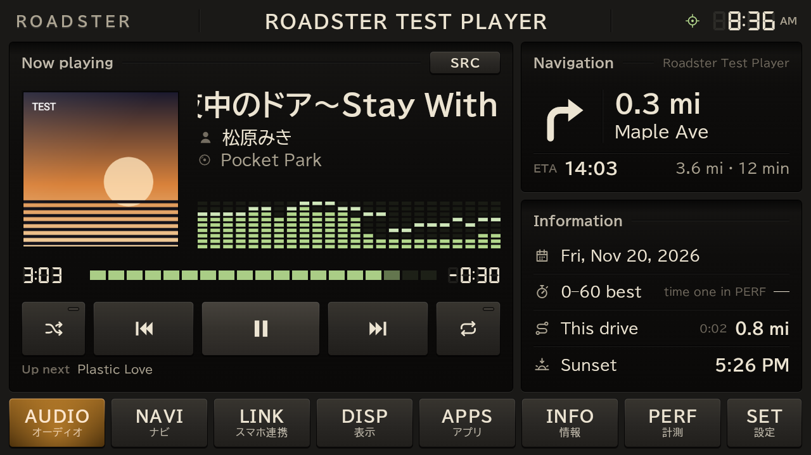
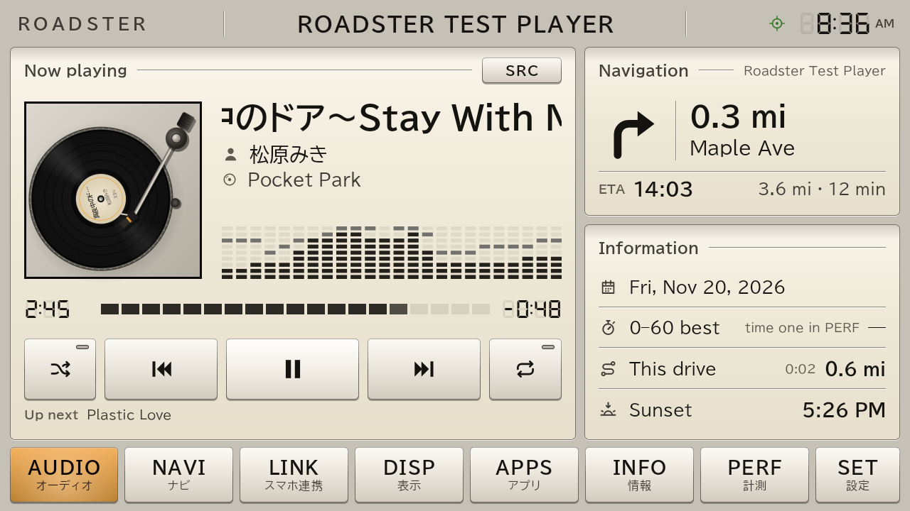
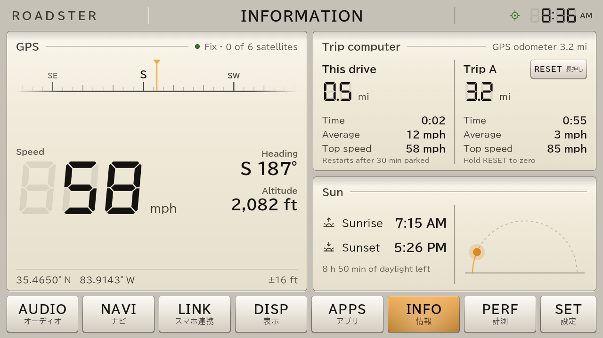
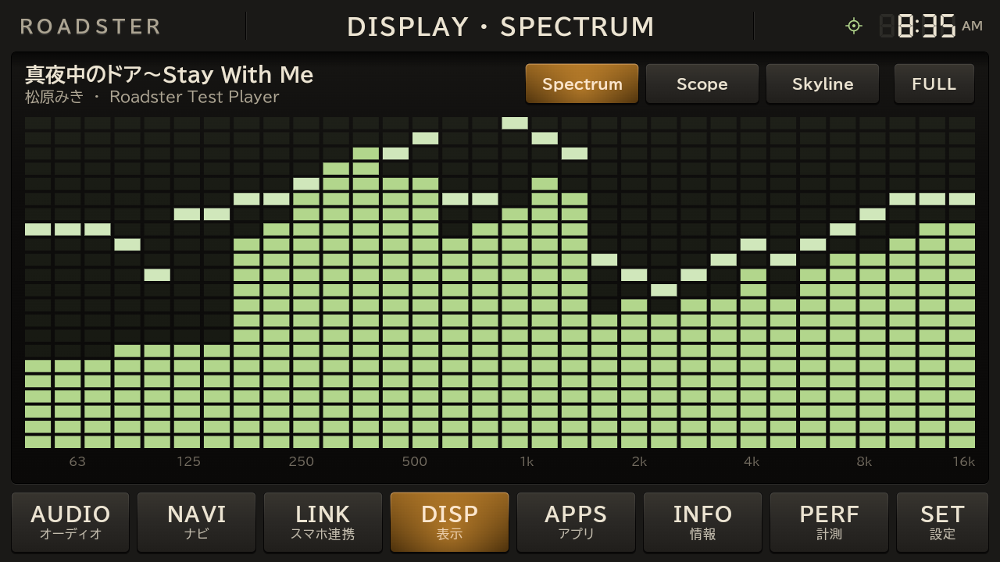
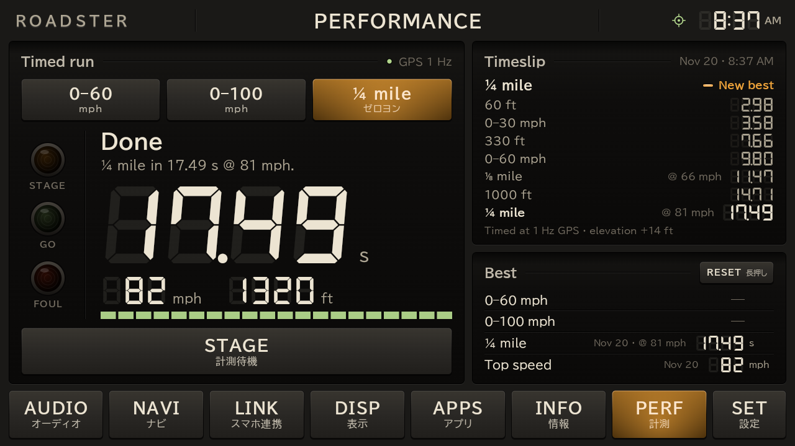
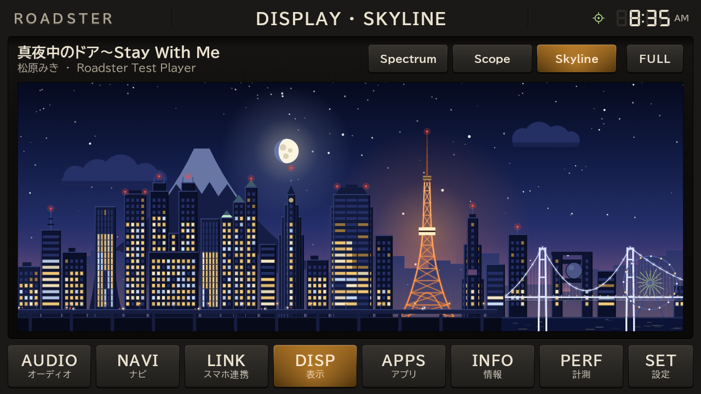
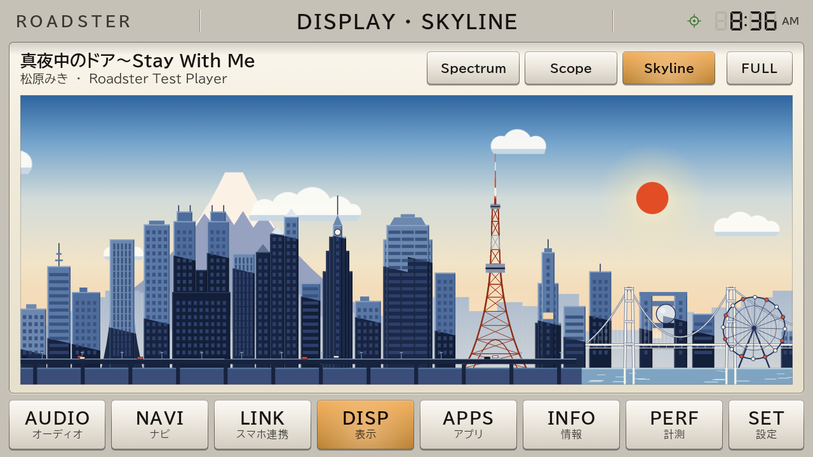
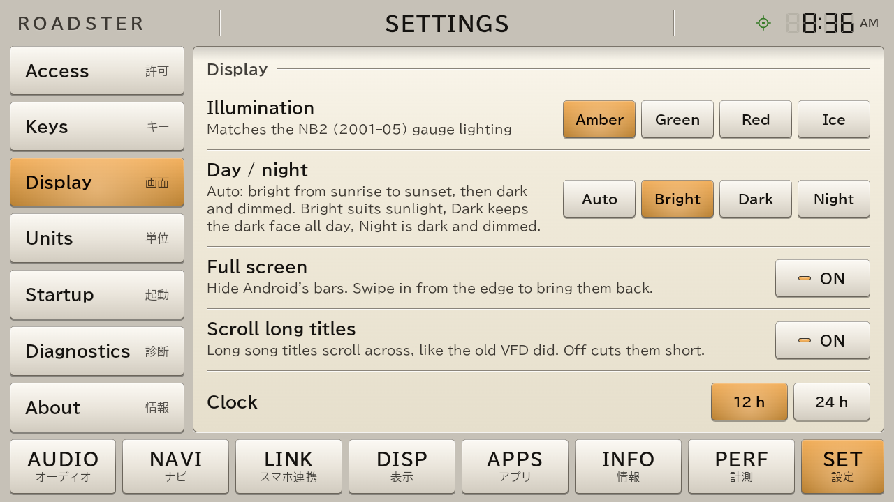

# Roadster

Roadster is a home screen app for an Android car head unit. Its design is the same as a Japanese double-DIN unit from approximately 2002. It is for the Mazda MX-5 of the NB generation (1998–2005).



## Description

Roadster shows the music, the next navigation turn and GPS data on one screen. It has satin keys, recessed LCD panels and amber key lights, as on the NB2 gauges.

The car does not connect to the head unit. Because of this, all data in Roadster comes from the head unit:

- The GPS receiver.
- The media sessions and notifications of other apps.
- The audio output of Android.

Roadster has a day face and a night face. The day face has light panels, because dark panels are difficult to read in sunlight on a dim screen. The night face has dark panels and lower brightness.

## Functions

| Key | Function |
| --- | --- |
| **AUDIO** オーディオ | The home page. It shows the music, the next turn and the trip data. |
| **NAVI** ナビ | Opens the map app. Push and hold the key to select a different app. |
| **LINK** スマホ連携 | Opens the CarPlay or Android Auto app of the head unit. |
| **DISP** 表示 | Shows a spectrum analyzer, an oscilloscope or a Tokyo skyline. Each one moves with the music. |
| **APPS** アプリ | Shows all the installed apps. |
| **INFO** 情報 | Shows the GPS speed, heading and altitude, the trip data and the times of sunrise and sunset. |
| **PERF** 計測 | Measures 0–60 mph, 0–100 mph and ¼ mile times with GPS. It records the best times and the top speed. |
| **SET** 設定 | Shows the settings. |

Other functions:

- **Turntable.** If the music has no cover art, a turntable turns with the music. The tonearm moves onto the record when the music starts.
- **Speed digits.** The 7-segment digits fade slowly, as on an LCD from 2002. This makes the GPS speed easier to read.
- **Trip computer.** Records two trips and a GPS odometer. A new drive starts after 30 minutes with no GPS fix.
- **Timed runs.** Push STAGE. Stop the car. When the screen shows Ready, start the run. The timer stops at the target speed or distance.
- **Top speed.** Roadster records the top speed of all drives. One incorrect GPS speed cannot change this record.
- **Skyline.** Each building shows one frequency band. At night, more windows have light when the band level increases. By day, a shadow moves up the buildings. The sun and the moon are at their real positions.
- **Key lights.** Select amber, green, red or ice blue.
- **Weather.** Shows the outside temperature from Open-Meteo. This function is off by default, because the head unit usually has no internet connection.

## Screenshots

The screenshots come from the Android emulator at 1280 × 720 pixels. The music, the route and the GPS data are test data.

| | |
| --- | --- |
|  |  |
| AUDIO page, day face. The turntable shows because the music has no cover art. | INFO page, day face, with GPS data and the trip computer. |
|  |  |
| DISP page, spectrum analyzer. | PERF page after a ¼ mile run. |
|  |  |
| DISP page, Tokyo skyline, night face. | DISP page, Tokyo skyline, day face. |
|  | |
| SET page, display settings. | |

## Requirements

- Android 8.0 (API level 26) or later.
- A landscape screen. The layout is for 1280 × 720 pixels. Roadster also operates on other sizes.
- A GPS receiver for the INFO page, the PERF page, the trips and the sun times.

## Installation

1. Build the APK. Refer to [Build](#build).
2. Copy the APK to a USB flash drive.
3. Connect the USB flash drive to the head unit.
4. Open the APK with the file manager of the head unit.
5. If Android asks, let the file manager install apps.

If the head unit has adb, use this command:

```bash
adb install -r app-release.apk
```

## Setup

1. Open Roadster.
2. Go to **SET › Access**.
3. Give these permissions:
   - **Media and navigation** (notification access). Roadster reads the music and the next turn from other apps.
   - **Location.** Roadster uses GPS for the INFO page, the PERF page, the trips and the sun times.
   - **Microphone.** Android gives the audio output to a visualizer only with this permission. Roadster does not record audio.
   - **Notifications.** The trip computer shows a small notification when it operates in the background.
4. Go to **SET › Keys**.
5. Select the CarPlay or Android Auto app for the LINK key.

NOTE: Some head units do not show the page for notification access. Then, use this adb command:

```bash
adb shell cmd notification allow_listener com.oemplus.roadster/.media.MediaListener
```

If Bluetooth music does not operate correctly, use **SET › Diagnostics**:

1. Play music from the phone.
2. Connect a USB flash drive to the head unit.
3. Push **Save**.
4. Attach the report file to a GitHub issue.

The report contains app names and song titles. It does not contain messages. Roadster hides addresses and phone numbers in the report.

## Build

You must have:

- JDK 17.
- Android SDK platform 35 and build-tools 35.0.0.

Procedure:

1. Set `JAVA_HOME` to JDK 17.
2. Set `ANDROID_HOME` to the Android SDK, or write `sdk.dir` in `local.properties`.
3. Run this command:

```bash
./gradlew assembleRelease
```

The APK is in `app/build/outputs/apk/release/`.

NOTE: The release build uses the debug key of your computer. Android installs an update only if the key is the same. Use the same computer, or the same key, for each update.

## Tests

Run the unit tests with this command:

```bash
./gradlew testDebugUnitTest
```

The unit tests examine the PERF timer, the top speed filter and the Bluetooth track text.

Two modules are for tests on the Android emulator only. Do not install them on a head unit.

- `testplayer` is a test music app. It plays a test tone, shows a media session and sends test navigation notifications.
- `fakemtc` is a test copy of the Bluetooth service on HCT head units.

Control the test music app with adb:

```bash
adb shell am broadcast -n com.oemplus.roadster.testplayer/.CmdReceiver --es cmd play
adb shell "am broadcast -n com.oemplus.roadster.testplayer/.CmdReceiver --es cmd nav --es title '0.3 mi' --es text 'Turn right onto Maple Ave'"
```

The scripts in `tools/` send GPS data to the emulator:

- `emu_launch.py` does a timed run: drive, stop, then launch.
- `emu_topspeed.py` drives to a peak speed. It can also send incorrect speeds.

## Project structure

| Folder | Contents |
| --- | --- |
| `app/src/main/java/.../apps` | The list of installed apps. |
| `app/src/main/java/.../core` | Settings, permissions and text formats. |
| `app/src/main/java/.../location` | GPS, trips, top speed, sun times and weather. |
| `app/src/main/java/.../media` | Media sessions, Bluetooth, navigation notifications and the audio analyzer. |
| `app/src/main/java/.../perf` | The PERF timer. |
| `app/src/main/java/.../system` | Start-up and diagnostics. |
| `app/src/main/java/.../ui` | The pages, the keys, the panels and the visualizers. |
| `app/src/test` | Unit tests. |
| `testplayer`, `fakemtc`, `tools` | Test tools for the emulator. |

## Known problems and future work

1. **Bluetooth music.** At this time, Roadster cannot read the track from Bluetooth music. Pause and skip do not control the music. The head unit has its own Bluetooth system. More work is necessary to find how this system operates.
2. **Navigation.** The NAVI key only opens Google Maps. The plan is a navigation function in Roadster.
3. **Launcher.** Roadster is an app, not a launcher. After the head unit starts again, Roadster does not operate as the home screen.
4. **Colors.** The colors are for a black and tan interior. Colors for other interiors are not available at this time.

## License

The source code has the Apache License 2.0. Refer to [LICENSE](LICENSE).

Third-party material:

- BIZ UDPGothic, by Morisawa Inc. SIL Open Font License 1.1.
- DSEG7, by keshikan. SIL Open Font License 1.1.
- Weather data from [Open-Meteo](https://open-meteo.com). CC BY 4.0. Roadster uses this data only when the weather function is on.

The font license texts are in `app/src/main/assets/licenses`.

Mazda, MX-5, CarPlay, Android Auto and Google Maps are trademarks of their owners. Roadster has no relation to these companies.
